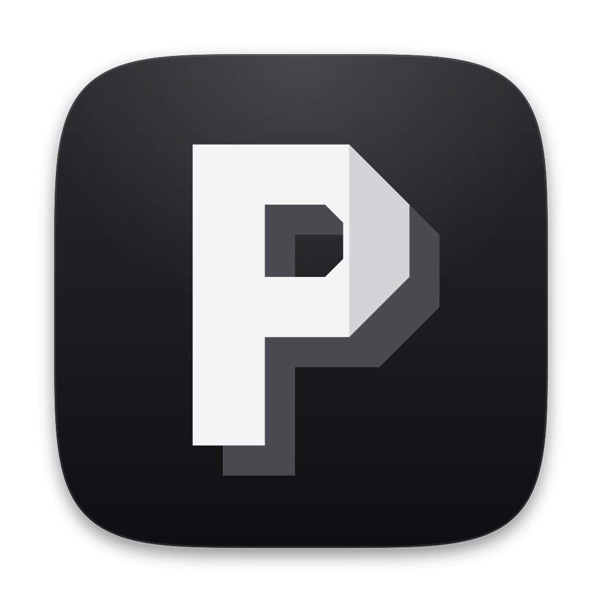
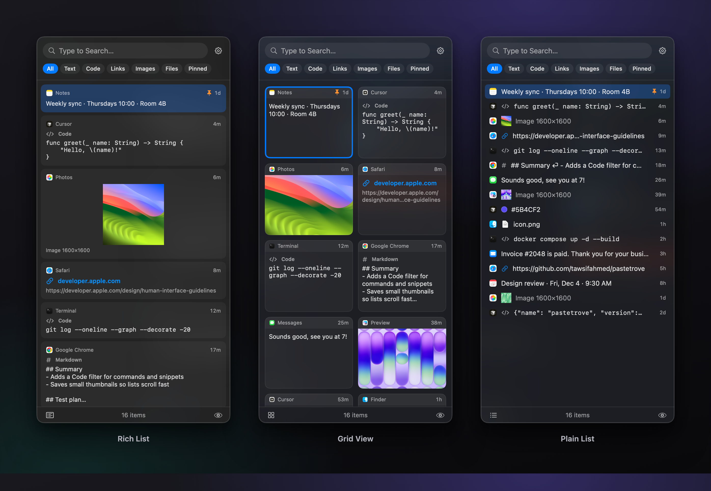
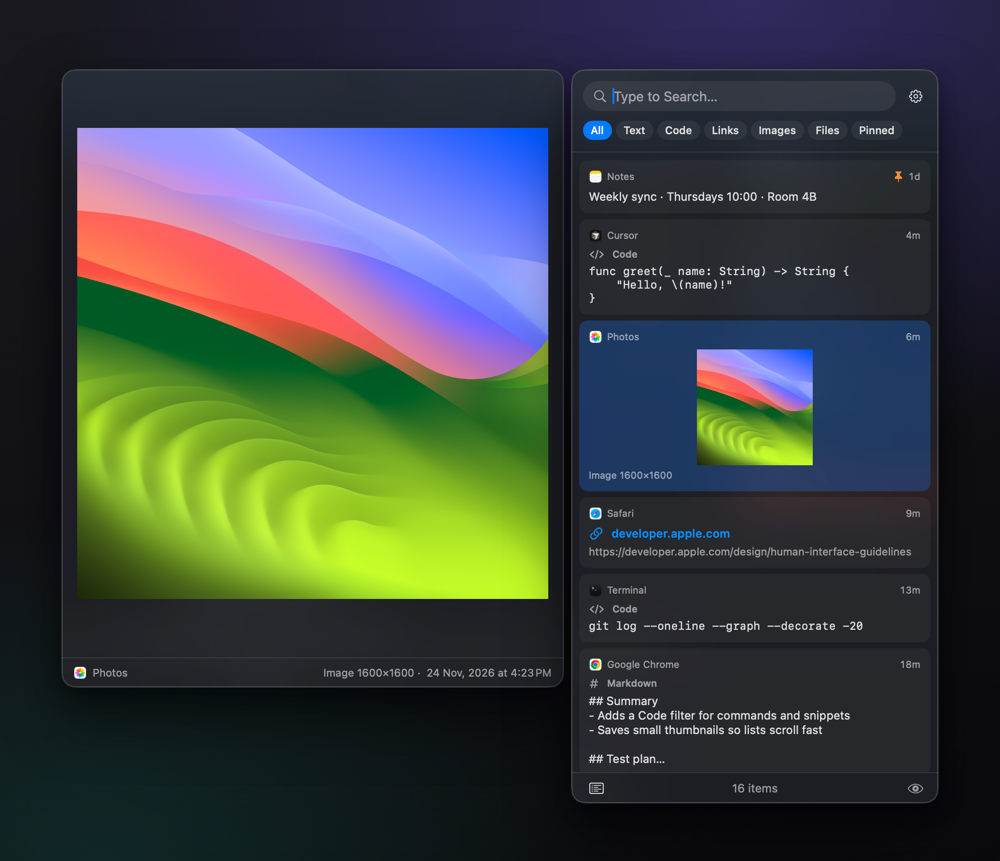
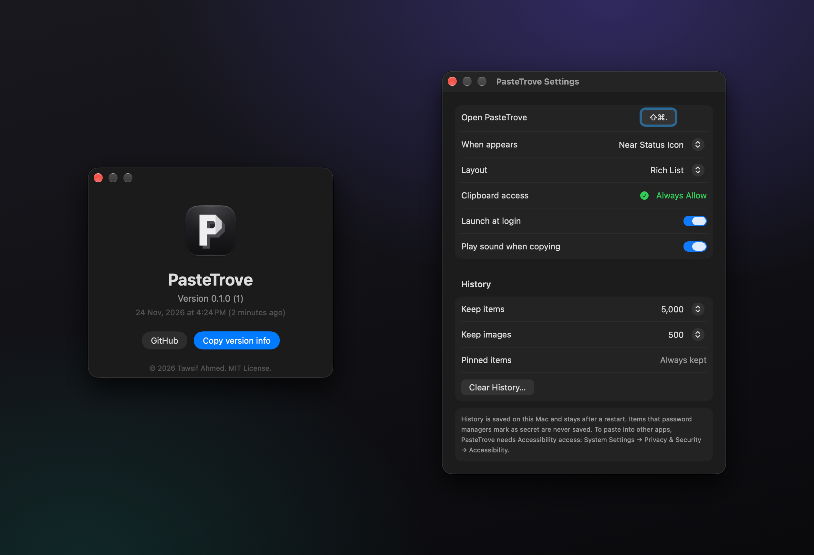

<h1 align="center">
  <br>
  PasteTrove
</h1>

<p align="center">
  A fast, local clipboard history for macOS.<br>
  Everything you copy (commands, code, PR snippets, links, screenshots, files) saved, searchable and one keystroke away.
</p>

<p align="center">
  <a href="https://github.com/tawsifahmed/pastetrove/releases/latest/download/PasteTrove.dmg"><b>Download PasteTrove.dmg</b></a>
  ·
  <a href="#install-with-homebrew">Homebrew</a>
  ·
  <a href="https://github.com/tawsifahmed/pastetrove/releases">Releases</a>
  ·
  <a href="https://github.com/tawsifahmed/pastetrove/issues">Report an issue</a>
</p>

<p align="center">
  
</p>

---

- **Native and light.** Swift and AppKit/SwiftUI, no dependencies, about 1 MB. Lives in the menu bar and uses almost no CPU when idle.
- **Private.** History is stored only on your Mac. No account and no sync. The only network request is a once-a-day check on GitHub for a new version, which you can turn off in Settings. Nothing from your clipboard is ever sent.
- **Keeps everything.** Text, rich text, code, Markdown, colors, links, images and files. History stays after a restart.
- **Fast to use.** One shortcut, type to search, ⏎ to paste into the app you were using.

## Install

Requires macOS 14 (Sonoma) or later, on Apple silicon or Intel.

### Download

1. Download [PasteTrove.dmg](https://github.com/tawsifahmed/pastetrove/releases/latest/download/PasteTrove.dmg).
2. Open it and drag **PasteTrove** to **Applications**.
3. Open PasteTrove from Applications.

PasteTrove is not notarized by Apple, so the first time macOS says it "cannot verify" the app. Open **System Settings → Privacy & Security**, scroll down and click **Open Anyway**. Or run this once in Terminal:

```sh
xattr -dr com.apple.quarantine /Applications/PasteTrove.app
```

### Install with Homebrew

```sh
brew tap tawsifahmed/pastetrove https://github.com/tawsifahmed/pastetrove
brew trust tawsifahmed/pastetrove
brew install --cask pastetrove
```

`brew trust` is needed once on Homebrew versions that only load casks from taps you trust. The cask clears the download quarantine flag for you.

PasteTrove updates itself: when a new version is out, it asks, then installs and relaunches. `brew upgrade --cask pastetrove` works too. Uninstall with `brew uninstall --cask pastetrove`, and add `--zap` to also remove your history and settings.

### First start

PasteTrove asks for two permissions. Both are needed only once.

1. **Accessibility** (shown as "Device Control and Data Access" on newer macOS). PasteTrove uses it to press ⌘V in the app you paste into. Without it, PasteTrove still copies the item and you press ⌘V yourself.
2. **Paste from Other Apps.** macOS asks each time an app reads the clipboard. In **System Settings → Privacy & Security → Paste from Other Apps**, set PasteTrove to **Always Allow**.

PasteTrove also turns on **Launch at login**, so your history is ready after a restart. You can turn it off in Settings.

## Use

Click the **P** in the menu bar, or press **⇧⌘V** (you can change it in Settings). Type to search, press **⏎** to paste.

When you copy something, PasteTrove plays a short sound and the menu bar icon flips. You can turn off the sound in Settings.

### Layouts

Pick a layout from the button in the bottom-left corner of the panel, or press ⌘L. Drag any edge of the panel to resize it; PasteTrove remembers the size, and Grid View adds columns as the panel gets wider.

| Layout | Shows |
|---|---|
| Plain List | One line per item. The most items on screen. |
| Rich List | Source app, age, and up to 5 lines of text or a large image. |
| Grid View | Cards in two columns. Best for screenshots and images. |

Press **Space** (with an empty search field) or **⌘Y** to open a large preview beside the panel.

<p align="center">
  
</p>

### Filters

All, Text, Code, Links, Images, Files and Pinned. Press ⇥ to go to the next filter.

PasteTrove recognizes **code** (terminal commands, source code, JSON, SQL), **Markdown** (for example a PR description) and **color values** (`#5b4cf2`, `rgb(…)`). Code shows in a monospaced font, and colors show a swatch.

### Keys

| Key | Action |
|---|---|
| Type | Search (every word must match) |
| ↑ ↓, ⌃N ⌃P | Move the selection (← → also move in Grid View) |
| ⌘↑ ⌘↓, Page Up / Page Down | Jump to the top or bottom, move by 10 |
| ⏎ | Paste |
| ⇧⏎ | Paste as plain text |
| ⌘⏎ | Copy and close, do not paste |
| ⌘C | Copy and keep the panel open |
| Hold ⌘, then 1 … 9 or 0 | Paste one of the first ten visible items (0 is the tenth). Holding ⌘ shows glowing numbers on them. |
| Space, ⌘Y | Preview |
| ⇥ / ⇧⇥ | Next / previous filter |
| ⌘P | Pin or unpin. Pinned items stay at the top and are never removed. |
| ⌘⌫ | Delete the item |
| ⌘L | Next layout |
| ⌘, | Settings |
| esc | Clear the search, then close |

Click an item to select it, double-click to paste. Right-click an item for Paste, Paste as Plain Text, Copy, Preview, Pin, Open Link, Show in Finder and Delete.

The gear menu has About, Settings, Pause Recording, Check for Updates, Clear History and Quit. Right-click the menu bar icon for the same menu.

### Settings

<p align="center">
  
</p>

- **Open PasteTrove**: click the button, then press the new shortcut. It needs ⌘, ⌥ or ⌃. Press esc to cancel.
- **When appears**: where the shortcut opens the panel: near the menu bar icon (default), near the cursor, or in the center of the screen.
- **Layout**, **Launch at login**, **Play sound when copying**
- **Clipboard access**: shows whether "Always Allow" is set, with a button to fix it.
- **Keep items** (500 to 10,000, default 2,000) and **Keep images** (50 to 500, default 200). The oldest unpinned items are removed first. Lowering a limit asks before deleting anything.
- **Clear History** removes all unpinned items.

### Open from other tools

`pastetrove://open` opens the panel, for Shortcuts, Raycast or scripts. Add `?layout=plain`, `rich` or `grid` to pick a layout. `pastetrove://settings` and `pastetrove://about` open those windows.

## Privacy

- PasteTrove ignores items that password managers mark as secret or temporary ([nspasteboard.org](http://nspasteboard.org) markers, used by 1Password, Bitwarden, KeePassXC and others).
- History is stored in `~/Library/Application Support/PasteTrove/history.sqlite`. Delete that folder to remove all history.

## Build from source

Requirements: macOS 14 or later, Xcode 15 or later (or the Swift 5.10+ command line tools).

```sh
git clone https://github.com/tawsifahmed/pastetrove.git
cd pastetrove
scripts/create-signing-cert.sh   # once per Mac, optional
scripts/build.sh install         # builds, copies PasteTrove.app to /Applications and starts it
```

`scripts/create-signing-cert.sh` creates a local signing certificate. With it, every build keeps the same identity, so macOS keeps PasteTrove's permissions after you rebuild. Without it, builds are signed ad hoc and macOS asks again after each build.

| Script | Does |
|---|---|
| `scripts/build.sh [install \| universal]` | Builds `build.noindex/PasteTrove.app` |
| `scripts/release.sh` | Universal build, `dist/PasteTrove-<version>.zip` and `dist/PasteTrove.dmg`, and the zip's sha256 in the cask |
| `scripts/make-icon.sh` | Redraws the app icon from `BrandMark.swift` |

### How it works

| Part | File | What it does |
|---|---|---|
| Clipboard watcher | `Monitor.swift` | Reads `NSPasteboard.changeCount` four times a second (macOS has no change event). Saves new content with the app it came from. Writes items back for pasting. |
| Storage | `Store.swift` | SQLite. `items` has the small rows the list needs. `reps` has the raw clipboard data per type, loaded only to preview or paste. The same content copied again moves to the top instead of making a duplicate. Pasting an item keeps its place. |
| Text types | `TextStyle.swift` | Recognizes code, Markdown and colors once, when an item is saved. |
| Panel | `Panel.swift` | A non-activating floating panel, so the app you came from stays active and receives the paste. Keys, list and gear menu. |
| List state | `Model.swift` | The items shown, selection, filters, layouts and in-memory search. |
| Rows | `Rows.swift` | Plain List rows, Rich List rows and Grid View cards. |
| Preview | `Preview.swift` | The large preview window beside the panel. |
| Caches | `Cache.swift` | App icons, thumbnails and text, so scrolling never reads the disk twice. |
| Shortcut and settings | `Settings.swift` | Global hotkey through Carbon `RegisterEventHotKey`, shortcut recorder, limits, launch at login through `SMAppService`. |
| Updates | `Updater.swift` | Checks GitHub Releases once a day. Installs a new version only when its checksum matches and macOS confirms it is signed with the same certificate as the running app. |
| Brand | `BrandMark.swift`, `About.swift` | The P mark for the menu bar and app icon, and the About window. |
| App | `main.swift` | Menu bar icon, menus, copy sound and icon flip, and the ⌘V key event that pastes. |

## License

[MIT](LICENSE)
